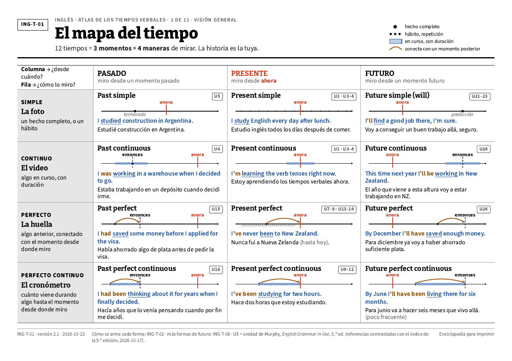
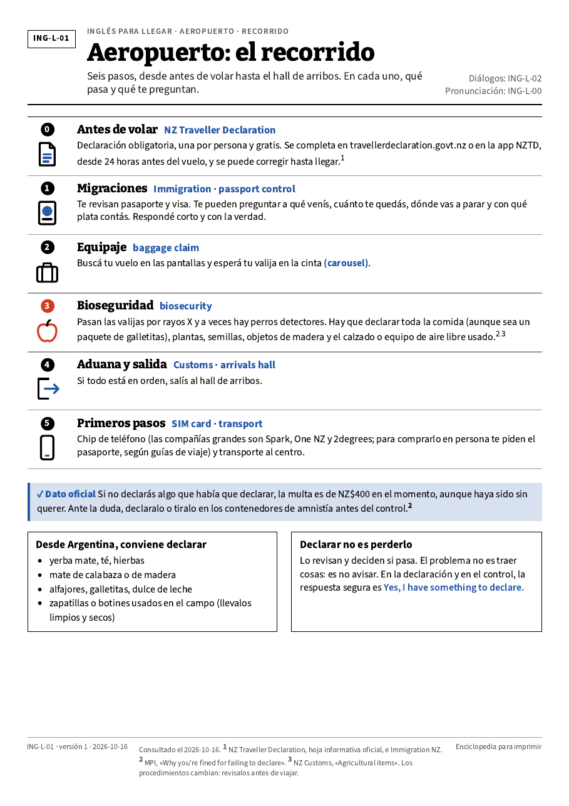
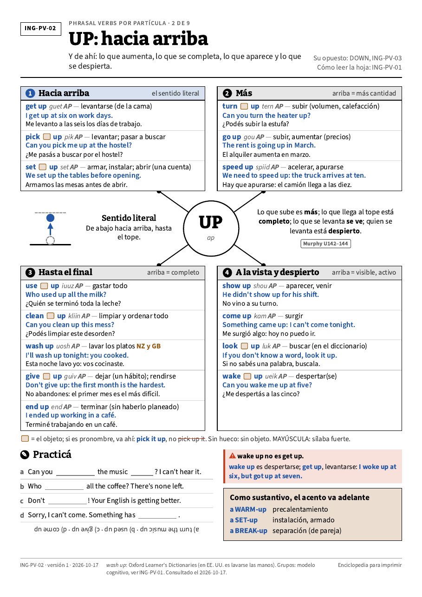

# Láminas de inglés para imprimir

> **In English:** 36 printable A4 sheets for Spanish speakers: a verb-tense atlas, practical English for arriving in New Zealand, and phrasal verbs by particle. Each sheet is HTML + SVG rendered to PDF with Chromium, and a script blocks the build if the layout breaks (text too small, overlapping, off the margin, too much ink). Built with Claude Code. The sheets themselves are in Spanish.

Treinta y seis láminas A4 para aprender inglés con la pared y un lápiz: el atlas de tiempos verbales, el inglés que se necesita para llegar a Nueva Zelanda y los phrasal verbs ordenados por partícula. Están escritas en español rioplatense y pensadas para una impresora de tinta hogareña y papel común de 75 g. Para imprimirlas alcanza con abrir el PDF.

|  |  |  |
|---|---|---|
| Atlas de tiempos verbales: el mapa del tiempo | Inglés para llegar: el recorrido del aeropuerto | Phrasal verbs: UP |

## Qué hay para imprimir

| Colección | Hojas | PDF completo |
|---|---|---|
| Atlas de tiempos verbales | 13 | [`salida/ATLAS-TIEMPOS-VERBALES-v2.pdf`](salida/ATLAS-TIEMPOS-VERBALES-v2.pdf) |
| Inglés para llegar a Nueva Zelanda | 12 | [`salida/INGLES-PARA-LLEGAR.pdf`](salida/INGLES-PARA-LLEGAR.pdf) |
| Phrasal verbs por partícula | 11 | [`salida/PHRASAL-VERBS.pdf`](salida/PHRASAL-VERBS.pdf) |

Para imprimir una sola hoja, abrí el compilado y elegí ese rango de páginas. En cada colección, las dos últimas hojas (`E1` y `E2`) son de escritura guiada: se escriben con lápiz sobre la hoja impresa.

**Para imprimir bien:** escala «Tamaño real» o 100 % (nunca «Ajustar a página», que descalibra las medidas), una sola cara, y la primera hoja del atlas va apaisada.

## Cómo se hizo

Tengo bases de programación, de la facultad y autodidactas, aunque nunca me dediqué a ella. Construyo con Claude Code y no practico *vibe coding*: como no reviso el código línea por línea, la calidad no depende de confiar en el resultado sino de dos controles: un chequeo automático que frena la construcción y hojas impresas en papel, para verlas de verdad.

Las decisiones de diseño fueron mías: qué colecciones hacían falta (tiempos verbales, inglés para llegar a Nueva Zelanda y phrasal verbs), una guía de estilo basada en la *Enciclopedia Combi Visual* que se usó como especificación, dejar afuera el campo para concentrarme en Nueva Zelanda y el inglés, y limitar la práctica a escritura guiada. También propuse nueve repositorios para reutilizar: Claude los leyó y descartó cuatro. Claude escribió las hojas, el generador y el chequeo, y los fue probando.

Cada lámina es un archivo HTML con SVG que Chromium convierte en un PDF vectorial A4. Antes de generar el PDF, un script mide la maquetación real y **frena** si encuentra letra de lectura de menos de 10 pt (8 pt en los metadatos), textos encimados o cortados, algo a menos de 8 mm del borde, o más de 20 % de tinta. El umbral de 10 pt salió de imprimir una hoja de calibración (`hojas/cal/`) y leerla a 40 cm; esa misma hoja decidió la tipografía y obligó a oscurecer el ocre, que impreso salía naranja.

## Qué conviene saber antes de confiar en el contenido

- Las hojas de Nueva Zelanda traen datos de trámites, salud, banco e impuestos. Se consultaron el **2026-10-16** y las doce hojas de esa colección citan sus fuentes al pie. Las reglas migratorias y de acceso a servicios cambian: verificalas en las páginas oficiales antes de decidir algo. Esto no es asesoramiento migratorio, médico ni impositivo.
- **Qué no se revisó.** El chequeo del constructor mide maquetación, no si el inglés es correcto. El contenido lo generó una IA y ningún docente de inglés lo revisó. Si encontrás un error, abrí un issue.
- Las etiquetas como **U7–8** remiten a unidades de *English Grammar in Use* (Raymond Murphy, Cambridge University Press, 5.ª edición). Son solo referencias de ubicación: el libro no se reproduce. El 2026-10-17 se contrastaron con el índice de la 5.ª edición y se corrigió una (*yet* está en la U7, no en la U8). No hay vínculo con la editorial ni con el autor.
- El estilo visual se inspira en la *Enciclopedia Combi Visual*. No hay vínculo con sus autores ni editores.
- La pronunciación está escrita con una convención propia pensada para hispanohablantes, no en símbolos fonéticos internacionales.

## Para regenerar o modificar las hojas

Hace falta Node 22 y un Chromium.

```bash
npm ci
CHROMIUM_PATH=/ruta/a/chromium node herramientas/construir.mjs hojas/ing-t/ING-T-01.html
```

Las hojas de phrasal verbs 02 a 09 salen de los datos de `herramientas/generar-pv.py`:

```bash
python3 herramientas/generar-pv.py hojas/ing-pv
node herramientas/construir.mjs hojas/ing-pv/*.html
```

Las hojas sueltas salen en `salida/ing-t/`, `salida/ing-l/` y `salida/ing-pv/`. Los compilados se arman uniéndolas en orden con `pdfunite` (de poppler-utils); por ejemplo, el atlas:

```bash
pdfunite salida/ing-t/ING-T-{01,02,03,04,05,06,07,08,09,10,11}.pdf salida/ing-t/ING-T-E1.pdf salida/ing-t/ING-T-E2.pdf salida/ATLAS-TIEMPOS-VERBALES-v2.pdf
```

Los PDF publicados salieron de la corrida original. Al reconstruir una hoja desde el HTML puede cambiar algún salto de línea: en `ING-T-10` medí 0,27 % de píxeles distintos.

`pruebas/errores.html` es una hoja hecha a propósito con cuatro errores: sirve para comprobar que el chequeo frena.

## Licencias

- **Hojas, PDF y vistas previas** (`hojas/`, `salida/`, `docs/`): [CC-BY-4.0](LICENSE). Podés usarlas, imprimirlas y modificarlas con atribución. El crédito que pide la licencia: «Láminas de inglés para imprimir, de Bruno Gutiérrez ([@bruneskycoder](https://github.com/bruneskycoder)), CC-BY-4.0».
- **Código** (`estilo/`, `herramientas/construir.mjs`, `herramientas/generar-pv.py`): [MIT](LICENSE-CODIGO).
- **Tipografías** (`fuentes/`): Bitter, Inter y Source Sans 3, bajo SIL Open Font License; las licencias están junto a los archivos.
- Las mediciones de maquetación de `construir.mjs` están adaptadas de EpicInfographics (MIT, © 2026 epic-infographics contributors); ver `herramientas/LICENCIA-epicinfographics.txt`.
